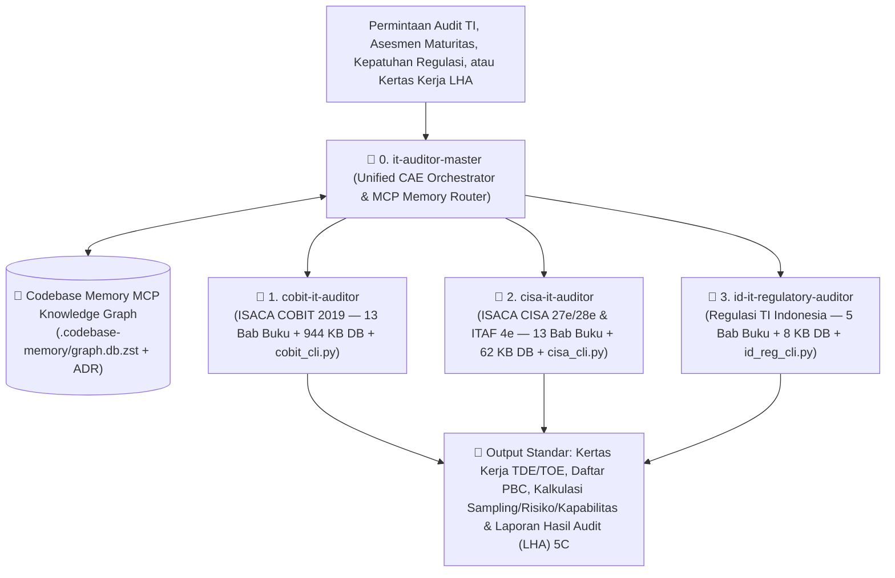

# 🛡️ Enterprise IT Auditor & Governance Suite (`elgptr/IT_Auditor`)

Ekosistem lengkap **4 Skill Buku Induk & Mesin Otomasi Audit/Tata Kelola TI** berstandar **ISACA (COBIT® 2019, CISA® 27e/28e, ITAF™ 4e, CRISC™)**, **IIA Audit Sampling**, dan **Regulasi Nasional Indonesia (OJK, BI, Kementerian BUMN, BSSN Indeks KAMI v5.0, UU PDP No. 27/2022, & Evaluasi 47 Indikator SPBE)** yang terintegrasi penuh dengan **Persistent Knowledge Graph (`codebase-memory-mcp`)**.

---

## 🏛️ Arsitektur 4-Skill Modular + Orkestrator CAE + Memory Base MCP



### Mengapa Arsitektur Ini Dibagi Menjadi 3 Skill Spesialis + 1 Skill Orkestrator + MCP Memory Base?
1. **Modular & Hemat Context Window (Anti-Bloat):**
   - Saat mengaudit perusahaan multinasional (SOX/Global), agen cukup memuat `cisa-it-auditor` dan `cobit-it-auditor`.
   - Saat mengaudit **Bank Umum (POJK 11/2022 & SEOJK 29/2022)**, **BUMN (PER-2/MBU/03/2023)**, **Kementerian/Pemda (SPBE 47 Indikator & Indeks KAMI BSSN v5.0)**, atau **Kepatuhan Privasi (UU PDP No. 27/2022)**, agen mengaktifkan `id-it-regulatory-auditor` yang memiliki kalkulator resmi untuk masing-masing regulasi Indonesia.
2. **Orkestrator Puncak (`it-auditor-master`):**
   - Bertindak sebagai *Chief Audit Executive (CAE)* yang secara otomatis mengoordinasikan **Tata Kelola (COBIT 2019)** + **Pengujian Teknis & Sampling (CISA)** + **Kepatuhan Hukum Nasional (Regulasi Indonesia)** melalui mesin [`audit_suite_cli.py`](./skills/it-auditor-master/scripts/audit_suite_cli.py).
3. **Persistent Knowledge Graph (`codebase-memory-mcp`):**
   - Seluruh repositori diindeks ke dalam *Knowledge Graph* (`.codebase-memory/graph.db.zst`) beserta *Architecture Decision Record (ADR)* sehingga agen AI langsung mengingat seluruh simbol fungsi, skrip CLI, dan struktur 31 bab buku referensi di setiap sesi baru.

---

## 🚀 Ringkasan Kapasitas Ekosistem (`4 Skills | 31 Bab Buku | >1 MB Database JSON | 4 Mesin CLI`)

| Nama Skill | Fokus & Standar Acuan | Kapasitas Buku, Database, & Mesin CLI |
| :--- | :--- | :--- |
| **[`it-auditor-master`](./skills/it-auditor-master/SKILL.md)** | **Orkestrator Utama (CAE Suite & MCP Memory Router)** | • Routing lintas-skill (COBIT + CISA + Regulasi RI)<br>• Integrasi **Codebase Memory MCP Knowledge Graph & ADR**<br>• Mesin CLI: [`audit_suite_cli.py`](./skills/it-auditor-master/scripts/audit_suite_cli.py) (`status`, `omni-search`) |
| **[`cobit-it-auditor`](./skills/cobit-it-auditor/SKILL.md)** | **ISACA COBIT® 2019** (*Core Framework, 40 Objectives, Design Guide, Implementation Guide, Focus Areas, AI & Zero Trust*) | • **13 Bab Buku Referensi** (~10.000 baris panduan & KKA)<br>• **Database JSON (944 KB):** `40 Objectives`, `231 Practices`, `1.202 Activities`, `33 RACI Roles`, `Figure A.1 & A.2`<br>• Mesin CLI: [`cobit_cli.py`](./skills/cobit-it-auditor/scripts/cobit_cli.py) (`lookup`, `cascade`, `capability`, `raci`, `diagnose`, `search`) |
| **[`cisa-it-auditor`](./skills/cisa-it-auditor/SKILL.md)** | **ISACA CISA® (27e & 28e), ITAF™ (4e), IIA Audit Sampling, SOX/ITGC Playbook, SAP/AD/Cloud/AI Audit, & QAE Bank** | • **13 Bab Buku Referensi** (5 Domain CISA, ITAF, IIA Sampling, SOXIT, SAP/AD/Cloud/K8s, AI/Ransomware, 30 QAE Scenarios)<br>• **Database JSON (62 KB):** `5 Domains`, `39 Tasks`, `17 ITAF Standards`, `18 SOXIT Key Controls (TDE/TOE/PBC)`<br>• Mesin CLI: [`cisa_cli.py`](./skills/cisa-it-auditor/scripts/cisa_cli.py) (`lookup`, `sampling`, `risk-calc`, `sod-check`, `pbc`, `caats`, `search`) |
| **[`id-it-regulatory-auditor`](./skills/id-it-regulatory-auditor/SKILL.md)** | **Regulasi TI & Siber Indonesia** (*OJK Perbankan, Kementerian BUMN, BSSN Indeks KAMI v5.0, PP 71/2019, UU PDP 27/2022, & SPBE*) | • **5 Bab Buku Referensi** (Pasal demi pasal & indikator kematangan)<br>• **Database JSON (8 KB):** Matriks *Crosswalk* Regulasi RI $\leftrightarrow$ COBIT 2019 $\leftrightarrow$ CISA<br>• Mesin CLI: [`id_reg_cli.py`](./skills/id-it-regulatory-auditor/scripts/id_reg_cli.py) (`spbe-calc`, `kami-calc`, `ojk-cyber`, `uupdp-check`, `crosswalk`) |

---

## 📘 1. `cobit-it-auditor` — 13 Bab Buku Induk & Mesin COBIT 2019

| Bab | Judul Bab & Tautan | Ringkasan Isi |
| :---: | :--- | :--- |
| **Bab 1** | [**Fondasi Eksekutif, Prinsip, 7 Komponen & Model Kapabilitas**](./skills/cobit-it-auditor/references/01-foundations-principles-and-7-components.md) | Tiga hasil EGIT, perbedaan *Governance* (`EDM`) vs *Management* (`APO`, `BAI`, `DSS`, `MEA`), **7 Komponen Tata Kelola (A–G)**, **Capability Level (0–5)**, dan *Hard Gate* **ISO/IEC 33000 (`N/P/L/F` >85%)**. |
| **Bab 2** | [**Mekanisme Goals Cascade, Matriks Figure A.1 & A.2 & Kamus Metrik**](./skills/cobit-it-auditor/references/02-goals-cascade-and-metrics-dictionary.md) | Kamus **13 Enterprise Goals (`EG01`–`EG13`)** & **13 Alignment Goals (`AG01`–`AG13`)**, matriks **Figure A.1 & A.2**, serta rumus prioritisasi *Top-Down* & *Bottom-Up*. |
| **Bab 3** | [**Domain EDM (Evaluate, Direct and Monitor) — `EDM01` s.d. `EDM05`**](./skills/cobit-it-auditor/references/03-domain-edm-governance-objectives.md) | 5 Objektif Tata Kelola, 16 Praktik, 85 Aktivitas (Level 2–5), RACI, Komponen C–G, dan Kertas Kerja Audit (KKA). |
| **Bab 4** | [**Domain APO Bagian 1 — `APO01` s.d. `APO07`**](./skills/cobit-it-auditor/references/04-domain-apo-management-objectives-part1.md) | Framework (`APO01`), Strategi (`APO02`), EA (`APO03`), Inovasi (`APO04`), Portofolio (`APO05`), Anggaran (`APO06`), dan SDM (`APO07`). |
| **Bab 5** | [**Domain APO Bagian 2 — `APO08` s.d. `APO14`**](./skills/cobit-it-auditor/references/05-domain-apo-management-objectives-part2.md) | Hubungan (`APO08`), SLA (`APO09`), Vendor (`APO10`), Mutu (`APO11`), Risiko (`APO12`), Keamanan/ISMS (`APO13`), dan **Data Governance (`APO14`)**. |
| **Bab 6** | [**Domain BAI (Build, Acquire and Implement) — `BAI01` s.d. `BAI11`**](./skills/cobit-it-auditor/references/06-domain-bai-management-objectives.md) | 11 Objektif Manajemen (Program, Requirements, SDLC, Availability, OCM, IT Changes, UAT, Knowledge, Assets, CMDB, Projects) — 74 Praktik, 401 Aktivitas. |
| **Bab 7** | [**Domain DSS (Deliver, Service and Support) — `DSS01` s.d. `DSS06`**](./skills/cobit-it-auditor/references/07-domain-dss-management-objectives.md) | 6 Objektif Operasional (Operations, Incidents, Problems/RCA, Continuity BCP/DRP, Security Services, Business Process Controls/ITAC) — 37 Praktik, 178 Aktivitas. |
| **Bab 8** | [**Domain MEA (Monitor, Evaluate and Assess) — `MEA01` s.d. `MEA04`**](./skills/cobit-it-auditor/references/08-domain-mea-management-objectives.md) | 4 Objektif Asurans (Performance, Internal Control, External Compliance, Managed Assurance) — 20 Praktik, 110 Aktivitas. |
| **Bab 9** | [**COBIT 2019 Design Factors (`DF1`–`DF11`), Tailoring & Diagnostik**](./skills/cobit-it-auditor/references/09-design-factors-and-tailoring-methodology.md) | 4 Arketipe Strategi (`DF1`), **19 Kategori Risiko TI (`DF3`)**, **20 Masalah Aktual I&T (`DF4` A–T)**, 4 Langkah *Design Workflow*, & *Awareness Diagnostic*. |
| **Bab 10** | [**COBIT 2019 Implementation Guide — Siklus Hidup 7 Fase & Business Case**](./skills/cobit-it-auditor/references/10-implementation-guide-7-phases-lifecycle.md) | **3 Cincin Konsentris** (*PM, CE, CI*), **10 Pain Points (`PP01`–`PP10`)**, **8 Trigger Events (`TE01`–`TE08`)**, Rincian Fase 1–7, & *EGIT Business Case*. |
| **Bab 11** | [**Direktori 33 Peran RACI, Deteksi SoD, Crosswalk & Template Audit 5C/LHA**](./skills/cobit-it-auditor/references/11-raci-roles-sod-crosswalk-and-5c-audit-templates.md) | **33 Peran Resmi (`Figure A.3`)**, **12 Pola Konflik SoD**, Crosswalk Internasional & Nasional, Kamus Risiko Bisnis, dan Template 5C & LHA. |
| **Bab 12** | [**COBIT 2019 Focus Area Guides — InfoSec, Risk (CRISC), DevOps, Cloud, & SME**](./skills/cobit-it-auditor/references/12-cobit-focus-areas-infosec-risk-devops-cloud-sme.md) | Fokus Area Keamanan Informasi, Skenario Risiko 5 Elemen **CRISC** (KGI/KPI/KRI/KCI), **DevOps Automated Gatekeepers**, **Cloud Shared Responsibility**, & Core SME Set. |
| **Bab 13** | [**Tata Kelola Teknologi Baru — AI / GenAI (ISO 42001) & Zero Trust (NIST 800-207)**](./skills/cobit-it-auditor/references/13-emerging-tech-ai-governance-and-zero-trust-cobit.md) | Matriks audit **AI/LLM** (*Hallucination, Bias, Data Poisoning, Prompt Injection, RAG RBAC*) dan **7 Pilar Zero Trust Architecture** dengan COBIT 2019. |

---

## 📗 2. `cisa-it-auditor` — 13 Bab Buku Induk & Mesin Eksekusi Audit CISA (27e/28e & ITAF 4e)

| Bab | Judul Bab & Tautan | Ringkasan Isi |
| :---: | :--- | :--- |
| **Bab 1** | [**Standar Profesional ISACA ITAF (4th Edition), Kode Etik, dan Audit Charter**](./skills/cisa-it-auditor/references/01-itaf-standards-ethics-and-audit-charter.md) | Bobot 5 Domain CISA & 39 Tasks, 7 Kode Etik ISACA, **17 Standar ITAF (`1001`–`1402`) & 17 Pedoman (`2001`–`2402`)**, *Audit Charter vs Engagement Letter*, serta ISO 19011/27007/27008. |
| **Bab 2** | [**Domain 1 — Proses Audit SI, Statistical Sampling (IIA), dan CAATs (21%)**](./skills/cisa-it-auditor/references/02-domain1-is-auditing-process-sampling-and-caats.md) | Model Risiko Audit ($\text{AR} = \text{IR} \times \text{CR} \times \text{DR}$), *Compliance vs Substantive*, **IIA Statistical Sampling** (Tabel Poisson $R$-Factor, Attribute, Discovery, MUS, Variable MPU, Tabel ITGC), **CAATs** (GAS, ITF, SCARF, Snapshot, Audit Hooks), & bukti audit. |
| **Bab 3** | [**Domain 2 — Tata Kelola dan Manajemen TI (17%)**](./skills/cisa-it-auditor/references/03-domain2-it-governance-and-management.md) | EGIT, *Strategy vs Steering Committee*, **Matriks SoD 12 Peran TI** & kontrol kompensasi, kontrol HR, risiko kuantitatif ($\text{SLE}, \text{ALE}$, ROI), **IT BSC**, dan laporan **SOC 1, SOC 2, SOC 3 (Type 1 vs Type 2 & CUECs)**. |
| **Bab 4** | [**Domain 3 (Bagian 1) — Tata Kelola Proyek, Metrik CPM/PERT/EVA, SDLC, dan Akuisisi (12%)**](./skills/cisa-it-auditor/references/04-domain3-part1-project-governance-sdlc-and-acquisition.md) | *Business Case*, WBS, **CPM & Slack**, rumus **PERT**, **Earned Value Analysis (EVA: BAC, PV, EV, AC, CV, SV, CPI, SPI, EAC, ETC)**, **FPA**, **10 Model SDLC**, RFP, dan **Software Escrow**. |
| **Bab 5** | [**Domain 3 (Bagian 2) — Kontrol Aplikasi (ITAC), Metodologi Pengujian, dan Migrasi Data (12%)**](./skills/cisa-it-auditor/references/05-domain3-part2-application-controls-testing-and-migration.md) | **ITAC** (*Input, Processing, Output*), *Batch Totals*, **12 Edit Checks** (*Check Digit*), **EDI/EFT/POS**, **12 Metode Pengujian Software** (UAT, Regression, Sociability, Parallel), & *Cutover*. |
| **Bab 6** | [**Domain 4 (Bagian 1) — Operasional SI, Perangkat Keras, Database, dan ITSM (23%)**](./skills/cisa-it-auditor/references/06-domain4-part1-is-operations-hardware-db-and-itsm.md) | *Job Scheduling*, USB/RFID, ITAM, **End-User Computing (EUC / Spreadsheet)**, **DBMS** (*Normalization, ACID, Concurrency*), serta **ITSM** (*Incident vs Problem, Change & Emergency Change, CMDB, SLA/OLA/UC*). |
| **Bab 7** | [**Domain 4 (Bagian 2) — Ketahanan Bisnis, BIA, BCP/DRP, RAID, Backup, dan Situs Pemulihan (23%)**](./skills/cisa-it-auditor/references/07-domain4-part2-business-resilience-bia-bcp-drp-and-backup.md) | Linimasa **BIA** (**RPO, RTO, WRT, MTD, SDO**), **RAID 0/1/5/6/10**, skema **Backup (Full, Incremental, Differential & GFS)**, **6 Jenis Recovery Sites** (*Mirrored, Hot, Warm, Cold, Mobile, Reciprocal*), & **5 Uji DRP**. |
| **Bab 8** | [**Domain 5 (Bagian 1) — Keamanan Informasi, Kontrol Fisik, IAM & Biometrik, dan Keamanan Jaringan (27%)**](./skills/cisa-it-auditor/references/08-domain5-part1-information-security-iam-and-network-security.md) | Trias CIA, *Data Owner vs Custodian*, keamanan fisik (*Mantrap, Dry-Pipe, FM-200*), biometrik (**FRR, FAR, CER/EER**), **SSO Kerberos**, **OSI 7 Layer**, **Firewall, DMZ, IDS vs IPS**, VPN, Wireless, & BYOD/MDM. |
| **Bab 9** | [**Domain 5 (Bagian 2) — Kriptografi, PKI, Tanda Tangan Digital, Serangan Siber, Pentest, dan Forensik Digital (27%)**](./skills/cisa-it-auditor/references/09-domain5-part2-cryptography-pki-attacks-pentest-and-forensics.md) | **Simetris vs Asimetris**, **Hash**, **Digital Signature vs Confidentiality vs Digital Envelope**, **PKI (CA, RA, CRL, OCSP)**, **14 Serangan Siber**, **VA vs Pentest**, **Incident Response**, & **Digital Forensics** (*Order of Volatility, Bit-Stream Image, Chain of Custody*). |
| **Bab 10** | [**Matriks Lengkap SOX/ITGC Key Controls (`SOXIT.01`–`SOXIT.04`), Daftar PBC, Walkthrough Unix/Oracle/SQL, & Studi Kasus**](./skills/cisa-it-auditor/references/10-soxit-itgc-key-controls-pbc-walkthrough-and-case-studies.md) | 18 kontrol kunci `SOXIT.01`–`04` (`TDE`, `TOE`, `PBC`), panduan teknis **Unix/Solaris/Linux**, **Oracle DB**, **SQL Server**, serta pembahasan **Studi Kasus PT XYZ (SAP ERP)** dan **PT Ramayana Lestari Sentosa Tbk**. |
| **Bab 11** | [**Pustaka Skrip Ekstraksi Bukti Teknis (Live Audit Queries) — SAP ERP/S4HANA, Active Directory, Cloud, & Kubernetes/CI-CD**](./skills/cisa-it-auditor/references/11-live-technical-audit-scripts-sap-ad-cloud-k8s.md) | **SAP T-Codes** (`SU01`, `SUIM`, `PFCG`, `SCC4`, `RZ10`, `STMS`, `SM19/SM20`, `OB52`) & Tabel (`USR02`, `UST04`, `AGR_USERS`, `T000`, `E070`), skrip PowerShell **Active Directory**, **AWS/Azure/GCP**, & **Kubernetes/GitHub Branch Protection SoD**. |
| **Bab 12** | [**Pembaruan Kurikulum CISA 28th Edition (2024–2026) — Audit Sistem AI/LLM, Zero Trust, & Playbook Ransomware**](./skills/cisa-it-auditor/references/12-cisa-28e-ai-auditing-zero-trust-and-ransomware-playbook.md) | Audit siklus hidup **AI/ML/LLM** (*Data Poisoning, Bias, Overfitting, Prompt Injection, Hallucination, Model Drift, XAI*), **Playbook Audit Ransomware (Backup 3-2-1-1-0)**, & **Blockchain/Smart Contracts/IoT/OT**. |
| **Bab 13** | [**Masterclass "ISACA Exam Mindset" & Bank 30 Skenario Soal CISA (QAE)**](./skills/cisa-it-auditor/references/13-cisa-exam-qae-mindset-and-scenario-bank.md) | 10 Hukum Emas menjawab soal jebakan CISA (*FIRST, NEXT, BEST, MOST, PRIMARY*) beserta 30 skenario kasus lintas Domain 1–5. |

---

## 📕 3. `id-it-regulatory-auditor` — 5 Bab Buku Induk & Mesin Kepatuhan Regulasi TI Indonesia

| Bab | Judul Bab & Tautan | Ringkasan Isi |
| :---: | :--- | :--- |
| **Bab 1** | [**Regulasi TI Perbankan & Jasa Keuangan — POJK 11/POJK.03/2022, SEOJK 29/SEOJK.03/2022, POJK 4/2021, & BI PJP**](./skills/id-it-regulatory-auditor/references/01-perbankan-ojk-pojk11-2022-seojk29-2022-dan-bi.md) | Bedah 12 Bab POJK PTI (kewajiban **Data Center & DRC di Indonesia Pasal 35–39** & uji DRP tahunan), matriks **Risiko Inheren vs Maturitas Keamanan Siber Level 1–5 (SEOJK 29/2022)**, & notifikasi insiden siber OJK **24 Jam**. |
| **Bab 2** | [**Regulasi Tata Kelola TI BUMN — Permen BUMN No. PER-2/MBU/03/2023 & Asesmen Maturity COBIT 2019 BUMN**](./skills/id-it-regulatory-auditor/references/02-bumn-per2-mbu-2023-cobit-maturity-dan-sinergi.md) | Mandat RSTI selaras RJPP/RKAP, *IT Steering Committee*, *Enterprise Architecture*, Sinergi & Satu Data BUMN, CSIRT BUMN, dan metodologi **COBIT 2019 Maturity Assessment BUMN (Target $\ge 3,00$)**. |
| **Bab 3** | [**Keamanan Siber Nasional — Indeks KAMI BSSN Versi 5.0 (ISO/IEC 27001:2022), PP 71/2019 (PSTE), & Peraturan BSSN No. 4/2021**](./skills/id-it-regulatory-auditor/references/03-bssn-indeks-kami-v5-pp71-2019-pste-dan-csirt.md) | Evaluasi **Kategori Sistem Elektronik (Rendah/Tinggi/Strategis)**, 6 Area Inti & 2 Suplemen Indeks KAMI v5.0, ambang kesiapan **SNI ISO/IEC 27001:2022**, serta **PSE Lingkup Publik vs Privat (PP 71/2019)**. |
| **Bab 4** | [**Audit Kepatuhan UU Nomor 27 Tahun 2022 tentang Pelindungan Data Pribadi (UU PDP)**](./skills/id-it-regulatory-auditor/references/04-uu-pdp-27-2022-privasi-dpia-dpo-dan-kepatuhan.md) | Data Pribadi Spesifik vs Umum (Pasal 4), 7 Dasar Pemrosesan Sah (Pasal 20), SLA **3x24 Jam** Hak Subjek Data, kewajiban **ROPA, DPIA, DPO**, **Notifikasi Kebocoran Data 3x24 Jam / 72 Jam (Pasal 46)**, Transfer Lintas Batas (Pasal 56), & **Denda 2% Pendapatan Tahunan (Pasal 57)**. |
| **Bab 5** | [**Evaluasi Sistem Pemerintahan Berbasis Elektronik (SPBE) — Perpres 95/2018 & PermenPANRB No. 59 Tahun 2020 (47 Indikator)**](./skills/id-it-regulatory-auditor/references/05-pemerintahan-spbe-permenpanrb-59-2020-47-indikator.md) | Bobot **4 Domain (Kebijakan 13%, Tata Kelola 25%, Manajemen 16,5%, Layanan 45,5%)**, **8 Aspek**, dan daftar lengkap **47 Indikator Evaluasi SPBE** beserta pemetaan COBIT 2019 & CISA. |

---

## ⚙️ 4. Panduan Penggunaan 4 Mesin CLI Python

```bash
# A. Orkestrator Master Suite (it-auditor-master)
python skills/it-auditor-master/scripts/audit_suite_cli.py status
python skills/it-auditor-master/scripts/audit_suite_cli.py omni-search --query "ransomware"

# B. Mesin COBIT 2019 (cobit-it-auditor)
python skills/cobit-it-auditor/scripts/cobit_cli.py cascade --eg EG02,EG03,EG06 --obj DSS04,DSS05 --top 10
python skills/cobit-it-auditor/scripts/cobit_cli.py capability --obj DSS04 --scores "2:92,3:78,4:40"
python skills/cobit-it-auditor/scripts/cobit_cli.py raci --check-sod "Head Development,Head IT Operations,Audit"

# C. Mesin CISA, Sampling IIA, CAATs Benford, & SOXIT (cisa-it-auditor)
python skills/cisa-it-auditor/scripts/cisa_cli.py lookup --id SAP
python skills/cisa-it-auditor/scripts/cisa_cli.py sampling --method attribute --confidence 95 --tolerable-error 0.05 --expected-deviations 0 --population 1000
python skills/cisa-it-auditor/scripts/cisa_cli.py risk-calc --mode ale --asset-value 1000000 --exposure-factor 0.40 --aro 0.20 --ef-post 0.10 --aro-post 0.20 --acs 15000
python skills/cisa-it-auditor/scripts/cisa_cli.py caats --test reconcile-users --terminated "budi,citra,eko" --active "andi,citra,deni,eko,fajar"

# D. Mesin Kepatuhan Regulasi Indonesia (id-it-regulatory-auditor)
python skills/id-it-regulatory-auditor/scripts/id_reg_cli.py spbe-calc --aspect-scores "3.5,3.2,3.8,3.0,3.4,3.0,4.0,3.8"
python skills/id-it-regulatory-auditor/scripts/id_reg_cli.py kami-calc --se-score 38 --security-score 725
python skills/id-it-regulatory-auditor/scripts/id_reg_cli.py ojk-cyber --inherent-risk 4 --maturity-level 2
python skills/id-it-regulatory-auditor/scripts/id_reg_cli.py uupdp-check --annual-revenue 500000000000 --hours-since-breach 80 --specific-data
```
