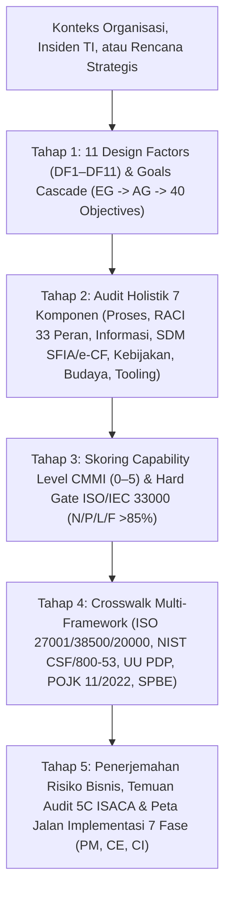

# 🛡️ IT Auditor & Governance Skills Collection (`elgptr/IT_Auditor`)

Repositori resmi kumpulan skill **Enterprise IT Auditor & IT Governance Architect** berstandar **ISACA (COBIT® 2019 & CISA®)** untuk AI Agent (**Antigravity CLI**, **Claude Code**, **Cursor**, dan **GitHub Copilot**).

---

## 🚀 Ringkasan Paket Skill

| Nama Skill | Fokus & Standar Acuan | Cakupan Materi & Alat |
| :--- | :--- | :--- |
| **[`cobit-it-auditor`](./skills/cobit-it-auditor/SKILL.md)** | **ISACA COBIT® 2019** (*Framework, Objectives, Design Guide, Implementation Guide & Toolkit v12*) | • **11 Bab Buku Referensi** (~9.000 baris panduan & Kertas Kerja Audit)<br>• **Database JSON Resmi** (`40 Objectives`, `231 Practices`, `1.202 Activities`, `33 Roles`, `Figure A.1 & A.2`)<br>• **Mesin CLI Python** ([`cobit_cli.py`](./skills/cobit-it-auditor/scripts/cobit_cli.py)) tanpa dependensi eksternal |
| **[`cisa-it-auditor`](./skills/cisa-it-auditor/SKILL.md)** | **ISACA CISA®** (*Certified Information Systems Auditor — 5 Domains*) | • Perancangan *Compliance* vs *Substantive Testing*<br>• Evaluasi **ITGC** & **ITAC**, SDLC, BCP/DRP, dan Keamanan Aset Informasi<br>• Pelaporan Temuan Audit Berformat **5C** |

---

## 📘 1. `cobit-it-auditor` — Buku Induk & Mesin Audit COBIT 2019

Skill [`cobit-it-auditor`](./skills/cobit-it-auditor/SKILL.md) dirancang menyerupai buku pegangan komprehensif sekaligus mesin kalkulasi otomatis untuk mengevaluasi tata kelola TI, merancang sistem EGIT (*Enterprise Governance of Information and Technology*), menghitung *Capability Level*, mendeteksi konflik *Segregation of Duties (SoD)*, dan menyusun Laporan Hasil Audit (LHA).

### Arsitektur Kerja `cobit-it-auditor`



### Daftar Lengkap 11 Bab Buku Referensi (`skills/cobit-it-auditor/references/`)

| Bab | Judul Bab & Tautan | Ringkasan Isi |
| :---: | :--- | :--- |
| **Bab 1** | [**Fondasi Eksekutif, Prinsip, 7 Komponen & Model Kapabilitas**](./skills/cobit-it-auditor/references/01-foundations-principles-and-7-components.md) | Tiga hasil utama EGIT (*Benefits Realization, Risk Optimization, Resource Optimization*), pemisahan tegas *Governance* (`EDM`) vs *Management* (`APO`, `BAI`, `DSS`, `MEA`), 6 Prinsip Sistem vs 3 Prinsip Framework, perbedaan COBIT 5 vs COBIT 2019, bedah **7 Komponen Sistem Tata Kelola (A–G)**, skema **Capability Level (0–5)**, **Maturity Level (0–5)**, dan aturan *Hard Gate* **ISO/IEC 33000 (`N/P/L/F` >85%)**. |
| **Bab 2** | [**Mekanisme Goals Cascade, Matriks Figure A.1 & A.2 & Kamus Metrik**](./skills/cobit-it-auditor/references/02-goals-cascade-and-metrics-dictionary.md) | Kamus lengkap **13 Enterprise Goals (`EG01`–`EG13`)** dan **13 Alignment Goals (`AG01`–`AG13`)** beserta metrik indikator resmi, tabel **Figure A.1** (`EG` $\leftrightarrow$ `AG` Primary/Secondary), tabel **Figure A.2** (`AG` $\leftrightarrow$ `40 Objectives` Primary/Secondary), serta rumus matematis prioritisasi *Top-Down* & *Bottom-Up*. |
| **Bab 3** | [**Domain EDM (Evaluate, Direct and Monitor) — `EDM01` s.d. `EDM05`**](./skills/cobit-it-auditor/references/03-domain-edm-governance-objectives.md) | 5 Objektif Tata Kelola (`EDM01` Governance Framework, `EDM02` Benefits Delivery, `EDM03` Risk Optimization, `EDM04` Resource Optimization, `EDM05` Stakeholder Engagement), 16 Praktik, 85 Aktivitas (Level 2–5), RACI, Komponen C–G, dan **Kertas Kerja Audit (KKA / PBC / ToD & ToE / Red Flags)**. |
| **Bab 4** | [**Domain APO Bagian 1 (Align, Plan and Organize) — `APO01` s.d. `APO07`**](./skills/cobit-it-auditor/references/04-domain-apo-management-objectives-part1.md) | `APO01` I&T Management Framework, `APO02` Strategy, `APO03` Enterprise Architecture, `APO04` Innovation, `APO05` Portfolio, `APO06` Budget & Costs, dan `APO07` Human Resources lengkap dengan praktik, aktivitas, level kapabilitas, RACI, dan KKA. |
| **Bab 5** | [**Domain APO Bagian 2 (Align, Plan and Organize) — `APO08` s.d. `APO14`**](./skills/cobit-it-auditor/references/05-domain-apo-management-objectives-part2.md) | `APO08` Relationships, `APO09` Service Agreements (SLA), `APO10` Vendors, `APO11` Quality (QMS), `APO12` Risk, `APO13` Security (ISMS), dan **`APO14` Managed Data (Data Governance)** lengkap dengan praktik, aktivitas, RACI, dan KKA. |
| **Bab 6** | [**Domain BAI (Build, Acquire and Implement) — `BAI01` s.d. `BAI11`**](./skills/cobit-it-auditor/references/06-domain-bai-management-objectives.md) | 11 Objektif Manajemen (`BAI01` Programs, `BAI02` Requirements, `BAI03` Solutions Identification & Build/SDLC, `BAI04` Availability & Capacity, `BAI05` Organizational Change, `BAI06` IT Changes/CAB, `BAI07` Change Acceptance & Transition/UAT, `BAI08` Knowledge, `BAI09` Assets/ITAM, `BAI10` Configuration/CMDB, `BAI11` Projects) — 74 Praktik, 401 Aktivitas, RACI, dan KKA. |
| **Bab 7** | [**Domain DSS (Deliver, Service and Support) — `DSS01` s.d. `DSS06`**](./skills/cobit-it-auditor/references/07-domain-dss-management-objectives.md) | 6 Objektif Operasional (`DSS01` Operations, `DSS02` Service Requests & Incidents, `DSS03` Problems/RCA, `DSS04` Continuity BCP/DRP, `DSS05` Security Services, `DSS06` Business Process Controls/ITAC) — 37 Praktik, 178 Aktivitas, RACI, dan KKA. |
| **Bab 8** | [**Domain MEA (Monitor, Evaluate and Assess) — `MEA01` s.d. `MEA04`**](./skills/cobit-it-auditor/references/08-domain-mea-management-objectives.md) | 4 Objektif Pemantauan & Asurans (`MEA01` Performance & Conformance, `MEA02` System of Internal Control, `MEA03` External Compliance, `MEA04` Managed Assurance) — 20 Praktik, 110 Aktivitas, RACI, dan KKA. |
| **Bab 9** | [**COBIT 2019 Design Factors (`DF1`–`DF11`), Tailoring & Diagnostik**](./skills/cobit-it-auditor/references/09-design-factors-and-tailoring-methodology.md) | 4 Arketipe Strategi (`DF1`), `DF2` Goals, **19 Kategori Risiko TI (`DF3`)**, **20 Masalah Aktual I&T (`DF4` Kode A–T)**, `DF5`–`DF11`, 4 Langkah *Governance System Design Workflow*, serta **7 Parameter Management Awareness Diagnostic** dari Toolkit v12. |
| **Bab 10** | [**COBIT 2019 Implementation Guide — Siklus Hidup 7 Fase & Business Case**](./skills/cobit-it-auditor/references/10-implementation-guide-7-phases-lifecycle.md) | Arsitektur **3 Cincin Konsentris** (*Program Management [PM]*, *Change Enablement [CE]*, *Continual Improvement [CI]*), katalog **10 Pain Points (`PP01`–`PP10`)** & **8 Trigger Events (`TE01`–`TE08`)**, rincian Tugas/Input/Output/RACI/CSFs **Fase 1 s.d. Fase 7**, dan template **EGIT Business Case**. |
| **Bab 11** | [**Direktori 33 Peran RACI, Deteksi SoD, Crosswalk & Template Audit 5C/LHA**](./skills/cobit-it-auditor/references/11-raci-roles-sod-crosswalk-and-5c-audit-templates.md) | Direktori **33 Peran Resmi (`Figure A.3`)** beserta beban `A`/`R`, **12 Pola Konflik Segregation of Duties (SoD) Kritis**, Crosswalk ke ISO 27001/38500/20000, NIST CSF 2.0/800-53, ITIL 4, TOGAF, PMBOK, CIS v8, **UU PDP No. 27/2022**, **POJK 11/2022 & SEOJK 29/2022**, **SPBE**, **BSSN**, Kamus Penerjemah Risiko Bisnis, dan Template 5C & LHA. |

---

## ⚙️ 2. Penggunaan Mesin Otomasi CLI (`cobit_cli.py`)

Skill ini dilengkapi mesin CLI Python mandiri ([`skills/cobit-it-auditor/scripts/cobit_cli.py`](./skills/cobit-it-auditor/scripts/cobit_cli.py)) yang membaca database resmi [`cobit2019_database.json`](./skills/cobit-it-auditor/data/cobit2019_database.json):

```bash
# 1. Lookup detail resmi Objektif (EDM01..MEA04), Praktik (mis. DSS04.04), EG, atau AG
python skills/cobit-it-auditor/scripts/cobit_cli.py lookup DSS04.04
python skills/cobit-it-auditor/scripts/cobit_cli.py lookup APO14

# 2. Kalkulasi Goals Cascade Top-Down (EG -> AG -> Prioritas Objektif & Target Capability)
#    sekaligus Bottom-Up (Objektif -> AG -> EG & Metrik Eksekutif untuk Temuan 5C)
python skills/cobit-it-auditor/scripts/cobit_cli.py cascade --eg EG02,EG03,EG06 --obj DSS04,DSS05 --top 10

# 3. Kalkulasi Skor Capability Level (CMMI 0-5 & Hard Gate ISO/IEC 33000 >85%)
python skills/cobit-it-auditor/scripts/cobit_cli.py capability --obj DSS04 --scores "2:92,3:78,4:40"

# 4. Audit Peran RACI & Deteksi Otomatis Konflik Segregation of Duties (SoD)
python skills/cobit-it-auditor/scripts/cobit_cli.py raci --role "Chief Information Security Officer"
python skills/cobit-it-auditor/scripts/cobit_cli.py raci --check-sod "Head Development,Head IT Operations,Audit"

# 5. Diagnosis Cepat Pain Points (PP01..PP10) ke Ruang Lingkup Objektif Prioritas
python skills/cobit-it-auditor/scripts/cobit_cli.py diagnose --pain-points PP02,PP04,PP10

# 6. Pencarian Teks Penuh di seluruh 1.202 Aktivitas, Metrik, dan Standar Terkait
python skills/cobit-it-auditor/scripts/cobit_cli.py search "ransomware"
python skills/cobit-it-auditor/scripts/cobit_cli.py search "ISO/IEC 27001"
```

---

## 💻 3. Cara Instalasi Skill

Salin folder skill di dalam direktori `skills/` ke direktori skill agen Anda:

```bash
# Clone repositori
git clone https://github.com/elgptr/IT_Auditor.git

# Salin ke direktori skill global Antigravity / Claude Code (.agents/skills/)
cp -r IT_Auditor/skills/cobit-it-auditor ~/.agents/skills/
cp -r IT_Auditor/skills/cisa-it-auditor ~/.agents/skills/
```

---

## 📂 4. Struktur Lengkap Repositori

```text
IT_Auditor/
├── README.md
└── skills/
    ├── cobit-it-auditor/
    │   ├── SKILL.md
    │   ├── data/
    │   │   └── cobit2019_database.json          # 944 KB Database Resmi (40 Obj, 231 Prac, 1.202 Act, 33 Roles)
    │   ├── scripts/
    │   │   └── cobit_cli.py                     # Mesin CLI Kalkulasi Cascade, Capability, RACI/SoD & Search
    │   └── references/
    │       ├── 01-foundations-principles-and-7-components.md
    │       ├── 02-goals-cascade-and-metrics-dictionary.md
    │       ├── 03-domain-edm-governance-objectives.md
    │       ├── 04-domain-apo-management-objectives-part1.md
    │       ├── 05-domain-apo-management-objectives-part2.md
    │       ├── 06-domain-bai-management-objectives.md
    │       ├── 07-domain-dss-management-objectives.md
    │       ├── 08-domain-mea-management-objectives.md
    │       ├── 09-design-factors-and-tailoring-methodology.md
    │       ├── 10-implementation-guide-7-phases-lifecycle.md
    │       └── 11-raci-roles-sod-crosswalk-and-5c-audit-templates.md
    └── cisa-it-auditor/
        └── SKILL.md
```
