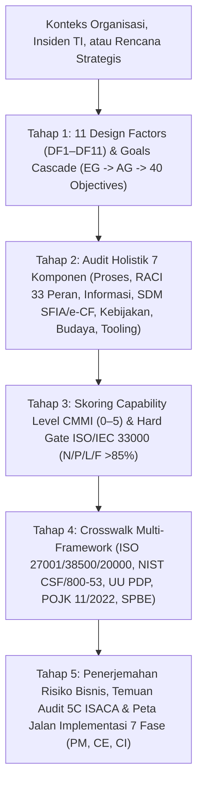
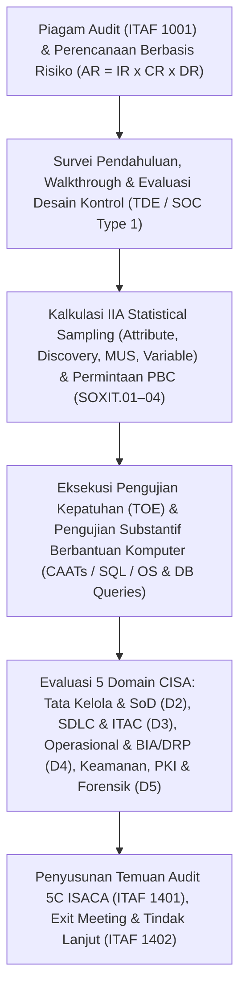

# 🛡️ IT Auditor & Governance Skills Collection (`elgptr/IT_Auditor`)

Repositori resmi kumpulan skill **Enterprise IT Auditor & IT Governance Architect** berstandar **ISACA (COBIT® 2019, CISA® 27th Edition, & ITAF™ 4th Edition)** untuk AI Agent (**Antigravity CLI**, **Claude Code**, **Cursor**, dan **GitHub Copilot**).

---

## 🚀 Ringkasan Paket Skill

| Nama Skill | Fokus & Standar Acuan | Cakupan Materi & Alat |
| :--- | :--- | :--- |
| **[`cobit-it-auditor`](./skills/cobit-it-auditor/SKILL.md)** | **ISACA COBIT® 2019** (*Framework, Objectives, Design Guide, Implementation Guide & Toolkit v12*) | • **11 Bab Buku Referensi** (~9.000 baris panduan & Kertas Kerja Audit)<br>• **Database JSON Resmi** (`40 Objectives`, `231 Practices`, `1.202 Activities`, `33 Roles`, `Figure A.1 & A.2`)<br>• **Mesin CLI Python** ([`cobit_cli.py`](./skills/cobit-it-auditor/scripts/cobit_cli.py)) tanpa dependensi eksternal |
| **[`cisa-it-auditor`](./skills/cisa-it-auditor/SKILL.md)** | **ISACA CISA® (27th Ed.)**, **ITAF™ (4th Ed.)**, **IIA Audit Sampling**, & **Big-4 SOX/ITGC Playbook** | • **10 Bab Buku Referensi** (Mencakup 5 Domain CISA, 39 Tasks, 17 Standar ITAF, Sampling IIA, Kriptografi/PKI, Forensik Digital, & Studi Kasus)<br>• **Database JSON Resmi** ([`cisa_database.json`](./skills/cisa-it-auditor/data/cisa_database.json) — `5 Domains`, `39 Tasks`, `17 ITAF Standards`, `18 SOXIT Key Controls` lengkap dengan `TDE`, `TOE`, & `PBC`)<br>• **Mesin CLI Python** ([`cisa_cli.py`](./skills/cisa-it-auditor/scripts/cisa_cli.py)) untuk kalkulasi *IIA Statistical Sampling*, *ALE/EVA/PERT*, *SoD Conflict Check*, & *PBC Generator* |

---

## 📘 1. `cobit-it-auditor` — Buku Induk & Mesin Audit COBIT 2019

Skill [`cobit-it-auditor`](./skills/cobit-it-auditor/SKILL.md) dirancang menyerupai buku pegangan komprehensif sekaligus mesin kalkulasi otomatis untuk mengevaluasi tata kelola TI, merancang sistem EGIT (*Enterprise Governance of Information and Technology*), menghitung *Capability Level*, mendeteksi konflik *Segregation of Duties (SoD)*, dan menyusun Laporan Hasil Audit (LHA).

### Arsitektur Kerja `cobit-it-auditor`



### Daftar Lengkap 11 Bab Buku Referensi COBIT 2019 (`skills/cobit-it-auditor/references/`)

| Bab | Judul Bab & Tautan | Ringkasan Isi |
| :---: | :--- | :--- |
| **Bab 1** | [**Fondasi Eksekutif, Prinsip, 7 Komponen & Model Kapabilitas**](./skills/cobit-it-auditor/references/01-foundations-principles-and-7-components.md) | Tiga hasil utama EGIT (*Benefits Realization, Risk Optimization, Resource Optimization*), pemisahan tegas *Governance* (`EDM`) vs *Management* (`APO`, `BAI`, `DSS`, `MEA`), 6 Prinsip Sistem vs 3 Prinsip Framework, perbedaan COBIT 5 vs COBIT 2019, bedah **7 Komponen Sistem Tata Kelola (A–G)**, skema **Capability Level (0–5)**, **Maturity Level (0–5)**, dan aturan *Hard Gate* **ISO/IEC 33000 (`N/P/L/F` >85%)**. |
| **Bab 2** | [**Mekanisme Goals Cascade, Matriks Figure A.1 & A.2 & Kamus Metrik**](./skills/cobit-it-auditor/references/02-goals-cascade-and-metrics-dictionary.md) | Kamus lengkap **13 Enterprise Goals (`EG01`–`EG13`)** dan **13 Alignment Goals (`AG01`–`AG13`)** beserta metrik indikator resmi, tabel **Figure A.1** (`EG` $\leftrightarrow$ `AG` Primary/Secondary), tabel **Figure A.2** (`AG` $\leftrightarrow$ `40 Objectives` Primary/Secondary), serta rumus matematis prioritisasi *Top-Down* & *Bottom-Up*. |
| **Bab 3** | [**Domain EDM (Evaluate, Direct and Monitor) — `EDM01` s.d. `EDM05`**](./skills/cobit-it-auditor/references/03-domain-edm-governance-objectives.md) | 5 Objektif Tata Kelola (`EDM01` Governance Framework, `EDM02` Benefits Delivery, `EDM03` Risk Optimization, `EDM04` Resource Optimization, `EDM05` Stakeholder Engagement), 16 Praktik, 85 Aktivitas (Level 2–5), RACI, Komponen C–G, dan **Kertas Kerja Audit (KKA / PBC / ToD & ToE / Red Flags)**. |
| **Bab 4** | [**Domain APO Bagian 1 (Align, Plan and Organize) — `APO01` s.d. `APO07`**](./skills/cobit-it-auditor/references/04-domain-apo-management-objectives-part1.md) | `APO01` I&T Management Framework, `APO02` Strategy, `APO03` Enterprise Architecture, `APO04` Innovation, `APO05` Portfolio, `APO06` Budget & Costs, dan `APO07` Human Resources lengkap dengan praktik, aktivitas, level kapabilitas, RACI, dan KKA. |
| **Bab 5** | [**Domain APO Bagian 2 (Align, Plan and Organize) — `APO08` s.d. `APO14`**](./skills/cobit-it-auditor/references/05-domain-apo-management-objectives-part2.md) | `APO08` Relationships, `APO09` Service Agreements (SLA), `APO10` Vendors, `APO11` Quality (QMS), `APO12` Risk, `APO13` Security (ISMS), dan **`APO14` Managed Data (Data Governance)** lengkap dengan praktik, aktivitas, RACI, dan KKA. |
| **Bab 6** | [**Domain BAI (Build, Acquire and Implement) — `BAI01` s.d. `BAI11`**](./skills/cobit-it-auditor/references/06-domain-bai-management-objectives.md) | 11 Objektif Manajemen (`BAI01` Programs, `BAI02` Requirements, `BAI03` Solutions Identification & Build/SDLC, `BAI04` Availability & Capacity, `BAI05` Organizational Change, `BAI06` IT Changes/CAB, `BAI07` Change Acceptance & Transition/UAT, `BAI08` Knowledge, `BAI09` Assets/ITAM, `BAI10` Configuration/CMDB, `BAI11` Projects) — 74 Praktik, 401 Aktivitas, RACI, dan KKA. |
| **Bab 7** | [**Domain DSS (Deliver, Service and Support) — `DSS01` s.d. `DSS06`**](./skills/cobit-it-auditor/references/07-domain-dss-management-objectives.md) | 6 Objektif Operasional (`DSS01` Operations, `DSS02` Service Requests & Incidents, `DSS03` Problems/RCA, `DSS04` Continuity BCP/DRP, `DSS05` Security Services, `DSS06` Business Process Controls/ITAC) — 37 Praktik, 178 Aktivitas, RACI, dan KKA. |
| **Bab 8** | [**Domain MEA (Monitor, Evaluate and Assess) — `MEA01` s.d. `MEA04`**](./skills/cobit-it-auditor/references/08-domain-mea-management-objectives.md) | 4 Objektif Pemantauan & Asurans (`MEA01` Performance & Conformance, `MEA02` System of Internal Control, `MEA03` External Compliance, `MEA04` Managed Assurance) — 20 Praktik, 110 Aktivitas, RACI, dan KKA. |
| **Bab 9** | [**COBIT 2019 Design Factors (`DF1`–`DF11`), Tailoring & Diagnostik**](./skills/cobit-it-auditor/references/09-design-factors-and-tailoring-methodology.md) | 4 Arketipe Strategi (`DF1`), `DF2` Goals, **19 Kategori Risiko TI (`DF3`)**, **20 Masalah Aktual I&T (`DF4` Kode A–T)**, `DF5`–`DF11`, 4 Langkah *Governance System Design Workflow*, serta **7 Parameter Management Awareness Diagnostic** dari Toolkit v12. |
| **Bab 10** | [**COBIT 2019 Implementation Guide — Siklus Hidup 7 Fase & Business Case**](./skills/cobit-it-auditor/references/10-implementation-guide-7-phases-lifecycle.md) | Arsitektur **3 Cincin Konsentris** (*Program Management [PM]*, *Change Enablement [CE]*, *Continual Improvement [CI]*), katalog **10 Pain Points (`PP01`–`PP10`)** & **8 Trigger Events (`TE01`–`TE08`)**, rincian Tugas/Input/Output/RACI/CSFs **Fase 1 s.d. Fase 7**, dan template **EGIT Business Case**. |
| **Bab 11** | [**Direktori 33 Peran RACI, Deteksi SoD, Crosswalk & Template Audit 5C/LHA**](./skills/cobit-it-auditor/references/11-raci-roles-sod-crosswalk-and-5c-audit-templates.md) | Direktori **33 Peran Resmi (`Figure A.3`)** beserta beban `A`/`R`, **12 Pola Konflik Segregation of Duties (SoD) Kritis**, Crosswalk ke ISO 27001/38500/20000, NIST CSF 2.0/800-53, ITIL 4, TOGAF, PMBOK, CIS v8, **UU PDP No. 27/2022**, **POJK 11/2022 & SEOJK 29/2022**, **SPBE**, **BSSN**, Kamus Penerjemah Risiko Bisnis, dan Template 5C & LHA. |

---

## 📗 2. `cisa-it-auditor` — Buku Induk & Mesin Eksekusi Audit Sistem Informasi (CISA 27e & ITAF 4e)

Skill [`cisa-it-auditor`](./skills/cisa-it-auditor/SKILL.md) mengintegrasikan seluruh kurikulum **ISACA CISA Review Manual (27th Edition)**, *Hemang Doshi CISA Study Guide*, **ISACA ITAF™ 4th Edition**, *IIA Internal Audit Sampling Guide*, matriks **SOX/ITGC Key Controls (`SOXIT.01`–`SOXIT.04`)**, serta kertas kerja teknis *Walkthrough* untuk **Unix/Solaris/Linux**, **Oracle Database**, **SQL Server**, dan **SAP ERP**.

### Arsitektur Kerja `cisa-it-auditor`



### Daftar Lengkap 10 Bab Buku Referensi CISA (`skills/cisa-it-auditor/references/`)

| Bab | Judul Bab & Tautan | Ringkasan Isi |
| :---: | :--- | :--- |
| **Bab 1** | [**Standar Profesional ISACA ITAF (4th Edition), Kode Etik, dan Audit Charter**](./skills/cisa-it-auditor/references/01-itaf-standards-ethics-and-audit-charter.md) | Pembobotan 5 Domain CISA & 39 Tasks, 7 Butir Kode Etik ISACA, **17 Standar Wajib ITAF (`1001`–`1402`) & 17 Pedoman (`2001`–`2402`)**, perbandingan *Audit Charter vs. Engagement Letter*, *Attestation vs. Direct Engagement*, serta keselarasan **ISO 19011, ISO/IEC 27007, & ISO/IEC TS 27008**. |
| **Bab 2** | [**Domain 1 — Proses Audit SI, Statistical Sampling (IIA), dan CAATs (21%)**](./skills/cisa-it-auditor/references/02-domain1-is-auditing-process-sampling-and-caats.md) | Siklus *Risk-Based Audit*, Model Risiko Audit ($\text{AR} = \text{IR} \times \text{CR} \times \text{DR}$), klasifikasi kontrol, *Compliance vs. Substantive Testing*, rumus lengkap **IIA Statistical Sampling** (Tabel Poisson $R$-Factor, Attribute, Stop-or-Go, Discovery, Variable MPU, MUS/PPS, dan tabel sampel ITGC), **CAATs** (GAS, ITF, SCARF, Snapshot, Audit Hooks, CIS), hierarki bukti audit, CSA, dan temuan **5C**. |
| **Bab 3** | [**Domain 2 — Tata Kelola dan Manajemen TI (17%)**](./skills/cisa-it-auditor/references/03-domain2-it-governance-and-management.md) | EGIT, *IT Strategy Committee vs. IT Steering Committee*, hierarki *Policies/Standards/Procedures/Guidelines*, **Matriks Konflik Segregation of Duties (SoD) 12 Peran TI** & kontrol kompensasinya, kontrol HR, perhitungan risiko kuantitatif ($\text{SLE} = \text{AV} \times \text{EF}$, $\text{ALE} = \text{SLE} \times \text{ARO}$, ROI Kontrol), **IT Balanced Scorecard (IT BSC)**, dan perbandingan laporan **SOC 1, SOC 2, SOC 3 (Type 1 vs. Type 2 & CUECs)**. |
| **Bab 4** | [**Domain 3 (Bagian 1) — Tata Kelola Proyek, Metrik CPM/PERT/EVA, SDLC, dan Akuisisi (12%)**](./skills/cisa-it-auditor/references/04-domain3-part1-project-governance-sdlc-and-acquisition.md) | *Business Case* & *Feasibility Study*, *Sponsor vs. Steering Committee*, WBS, **CPM & Slack/Float**, rumus **PERT**, rumus lengkap **Earned Value Analysis (EVA: BAC, PV, EV, AC, CV, SV, CPI, SPI, EAC, ETC)**, **FPA**, *Timeboxing*, perbandingan **10 Model SDLC**, RFP, dan **Software Escrow**. |
| **Bab 5** | [**Domain 3 (Bagian 2) — Kontrol Aplikasi (ITAC), Metodologi Pengujian, dan Migrasi Data (12%)**](./skills/cisa-it-auditor/references/05-domain3-part2-application-controls-testing-and-migration.md) | Arsitektur **ITAC** (*Input, Processing, Output*), *Batch Totals* (*Financial, Hash, Record Count*), **12 Jenis Edit Validation Checks** (*Check Digit Mod-10/11*), kontrol **EDI, EFT, POS, E-Banking**, **12 Metode Pengujian Software** (*Unit, Integration, System, Regression, Sociability, Pilot, Parallel, White/Black-Box, Alpha/Beta, UAT*), sanitasi data uji, dan *Cutover* (*Parallel, Phased, Abrupt*). |
| **Bab 6** | [**Domain 4 (Bagian 1) — Operasional SI, Perangkat Keras, Database, dan ITSM (23%)**](./skills/cisa-it-auditor/references/06-domain4-part1-is-operations-hardware-db-and-itsm.md) | *Job Scheduling* & *Console Logs*, pemantauan hardware, USB/RFID, ITAM & lisensi software, risiko **End-User Computing (EUC / Spreadsheet)**, arsitektur **DBMS** (*3-Schema, Normalization, Referential Integrity, ACID, Concurrency Locking*), serta **ITSM** (*Incident vs. Problem Management*, *Change & Emergency Change*, CMDB, *Patching*, dan **SLA / OLA / UC**). |
| **Bab 7** | [**Domain 4 (Bagian 2) — Ketahanan Bisnis, BIA, BCP/DRP, RAID, Backup, dan Situs Pemulihan (23%)**](./skills/cisa-it-auditor/references/07-domain4-part2-business-resilience-bia-bcp-drp-and-backup.md) | Linimasa metrik **BIA** (**RPO, RTO, WRT, MTD/MTO, SDO/MBCO, AIW** dengan $\text{RTO} + \text{WRT} \le \text{MTD}$), perbandingan **RAID 0, 1, 5, 6, dan 10**, redundansi telekomunikasi, skema **Backup (Full, Incremental, Differential & Rotasi GFS)**, perbandingan **6 Jenis Alternate Recovery Sites** (*Mirrored, Hot, Warm, Cold, Mobile, Reciprocal*), dan **5 Metode Pengujian DRP**. |
| **Bab 8** | [**Domain 5 (Bagian 1) — Keamanan Informasi, Kontrol Fisik, IAM & Biometrik, dan Keamanan Jaringan (27%)**](./skills/cisa-it-auditor/references/08-domain5-part1-information-security-iam-and-network-security.md) | Trias CIA, **Data Owner vs. Custodian**, keamanan fisik (*Mantrap*, **Dry-Pipe vs. Wet-Pipe**, **FM-200 / Inergen**, UPS), model akses (*MAC, DAC, RBAC, ABAC*), biometrik (**FRR [Type I], FAR [Type II], CER/EER**), **SSO (Kerberos & SAML)**, **Model OSI 7 Layer**, **4 Jenis Firewall**, **DMZ**, **IDS vs. IPS**, VPN, Wireless, Virtualisasi, BYOD/MDM, dan DLP. |
| **Bab 9** | [**Domain 5 (Bagian 2) — Kriptografi, PKI, Tanda Tangan Digital, Serangan Siber, Pentest, dan Forensik Digital (27%)**](./skills/cisa-it-auditor/references/09-domain5-part2-cryptography-pki-attacks-pentest-and-forensics.md) | Kriptografi **Simetris (AES/3DES) vs. Asimetris (RSA/ECC/DH)**, fungsi **Hash (SHA-2/3)**, mekanisme **Digital Signature vs. Enkripsi Kerahasiaan vs. Digital Envelope**, ekosistem **PKI (CA, RA, CPS, CRL, OCSP)**, **14 Serangan Siber & Mitigasinya**, **VA vs. Pentest**, **6 Fase Incident Response**, dan **Digital Forensics** (*Order of Volatility, Write-Blocker, Bit-Stream Image, Chain of Custody*). |
| **Bab 10** | [**Matriks Lengkap SOX/ITGC Key Controls (`SOXIT.01`–`SOXIT.04`), Daftar PBC, Panduan Teknis Walkthrough, dan Studi Kasus Nyata**](./skills/cisa-it-auditor/references/10-soxit-itgc-key-controls-pbc-walkthrough-and-case-studies.md) | Matriks lengkap 18 kontrol kunci `SOXIT.01`–`SOXIT.04` (`TDE`, `TOE`, `PBC`), panduan teknis **Unix/Solaris/Linux** (`/etc/passwd`, `/etc/shadow`, `UID=0`, `/etc/inetd.conf`), **Oracle DB** (`DBA_USERS`, `DBA_PROFILES`, `DBA_SYS_PRIVS`, `PUBLIC`), **SQL Server** (`xp_cmdshell`), serta pembahasan **Studi Kasus PT XYZ (SAP ERP)** dan **PT Ramayana Lestari Sentosa Tbk (MARIS/MAGIC)**. |

---

## ⚙️ 3. Penggunaan Mesin Otomasi CLI (`cobit_cli.py` & `cisa_cli.py`)

### A. Mesin CLI COBIT 2019 (`skills/cobit-it-auditor/scripts/cobit_cli.py`)

```bash
# 1. Lookup detail resmi Objektif (EDM01..MEA04), Praktik (mis. DSS04.04), EG, atau AG
python skills/cobit-it-auditor/scripts/cobit_cli.py lookup DSS04.04

# 2. Kalkulasi Goals Cascade Top-Down & Bottom-Up
python skills/cobit-it-auditor/scripts/cobit_cli.py cascade --eg EG02,EG03,EG06 --obj DSS04,DSS05 --top 10

# 3. Kalkulasi Skor Capability Level (CMMI 0-5 & Hard Gate ISO/IEC 33000 >85%)
python skills/cobit-it-auditor/scripts/cobit_cli.py capability --obj DSS04 --scores "2:92,3:78,4:40"

# 4. Audit Peran RACI & Deteksi Otomatis Konflik Segregation of Duties (SoD)
python skills/cobit-it-auditor/scripts/cobit_cli.py raci --check-sod "Head Development,Head IT Operations,Audit"
```

### B. Mesin CLI CISA (`skills/cisa-it-auditor/scripts/cisa_cli.py`)

```bash
# 1. Lookup Domain (D1-D5), Task (T1-T39), Standar ITAF (1001-1402), Kontrol SOXIT, atau Panduan Teknis (BIA, UNIX, ORACLE)
python skills/cisa-it-auditor/scripts/cisa_cli.py lookup --id D5
python skills/cisa-it-auditor/scripts/cisa_cli.py lookup --id 1205
python skills/cisa-it-auditor/scripts/cisa_cli.py lookup --id SOXIT.03.00.00.C4
python skills/cisa-it-auditor/scripts/cisa_cli.py lookup --id ORACLE

# 2. Kalkulator IIA Statistical Sampling (Attribute, Discovery, MUS, Variable, atau Tabel ITGC)
python skills/cisa-it-auditor/scripts/cisa_cli.py sampling --method attribute --confidence 95 --tolerable-error 0.05 --expected-deviations 0 --population 1000
python skills/cisa-it-auditor/scripts/cisa_cli.py sampling --method mus --confidence 95 --book-value 5000000 --tolerable-misstatement 250000

# 3. Kalkulator Risiko Kuantitatif (SLE/ALE/ROI), Proyek (EVA & PERT), dan Audit Risk (AR=IR*CR*DR)
python skills/cisa-it-auditor/scripts/cisa_cli.py risk-calc --mode ale --asset-value 1000000 --exposure-factor 0.40 --aro 0.20 --ef-post 0.10 --aro-post 0.20 --acs 15000
python skills/cisa-it-auditor/scripts/cisa_cli.py risk-calc --mode eva --bac 200000 --pv 100000 --ev 80000 --ac 110000

# 4. Detektor Konflik Segregation of Duties (SoD) 12 Peran TI & Rekomendasi Kontrol Kompensasi
python skills/cisa-it-auditor/scripts/cisa_cli.py sod-check --roles "developer,operator,security_admin"

# 5. Generator Program Kerja Audit (TDE/TOE) & Daftar Permintaan Dokumen (PBC) SOX/ITGC
python skills/cisa-it-auditor/scripts/cisa_cli.py pbc --domain SOXIT.02
```

---

## 💻 4. Cara Instalasi Skill

Salin folder skill di dalam direktori `skills/` ke direktori skill agen Anda:

```bash
# Clone repositori
git clone https://github.com/elgptr/IT_Auditor.git

# Salin ke direktori skill global Antigravity / Claude Code (.agents/skills/)
cp -r IT_Auditor/skills/cobit-it-auditor ~/.agents/skills/
cp -r IT_Auditor/skills/cisa-it-auditor ~/.agents/skills/
```

---

## 📂 5. Struktur Lengkap Repositori

```text
IT_Auditor/
├── README.md
└── skills/
    ├── cobit-it-auditor/
    │   ├── SKILL.md
    │   ├── data/
    │   │   └── cobit2019_database.json          # 944 KB Database Resmi (40 Obj, 231 Prac, 1.202 Act, 33 Roles)
    │   ├── scripts/
    │   │   └── cobit_cli.py                     # Mesin CLI Kalkulasi Cascade, Capability, RACI/SoD & Search
    │   └── references/
    │       ├── 01-foundations-principles-and-7-components.md
    │       ├── 02-goals-cascade-and-metrics-dictionary.md
    │       ├── 03-domain-edm-governance-objectives.md
    │       ├── 04-domain-apo-management-objectives-part1.md
    │       ├── 05-domain-apo-management-objectives-part2.md
    │       ├── 06-domain-bai-management-objectives.md
    │       ├── 07-domain-dss-management-objectives.md
    │       ├── 08-domain-mea-management-objectives.md
    │       ├── 09-design-factors-and-tailoring-methodology.md
    │       ├── 10-implementation-guide-7-phases-lifecycle.md
    │       └── 11-raci-roles-sod-crosswalk-and-5c-audit-templates.md
    └── cisa-it-auditor/
        ├── SKILL.md
        ├── data/
        │   └── cisa_database.json               # 62 KB Database Resmi (5 Domains, 39 Tasks, 17 ITAF, 18 SOXIT)
        ├── scripts/
        │   └── cisa_cli.py                      # Mesin CLI IIA Sampling, ALE/EVA/PERT, SoD Check & PBC Generator
        └── references/
            ├── 01-itaf-standards-ethics-and-audit-charter.md
            ├── 02-domain1-is-auditing-process-sampling-and-caats.md
            ├── 03-domain2-it-governance-and-management.md
            ├── 04-domain3-part1-project-governance-sdlc-and-acquisition.md
            ├── 05-domain3-part2-application-controls-testing-and-migration.md
            ├── 06-domain4-part1-is-operations-hardware-db-and-itsm.md
            ├── 07-domain4-part2-business-resilience-bia-bcp-drp-and-backup.md
            ├── 08-domain5-part1-information-security-iam-and-network-security.md
            ├── 09-domain5-part2-cryptography-pki-attacks-pentest-and-forensics.md
            └── 10-soxit-itgc-key-controls-pbc-walkthrough-and-case-studies.md
```
